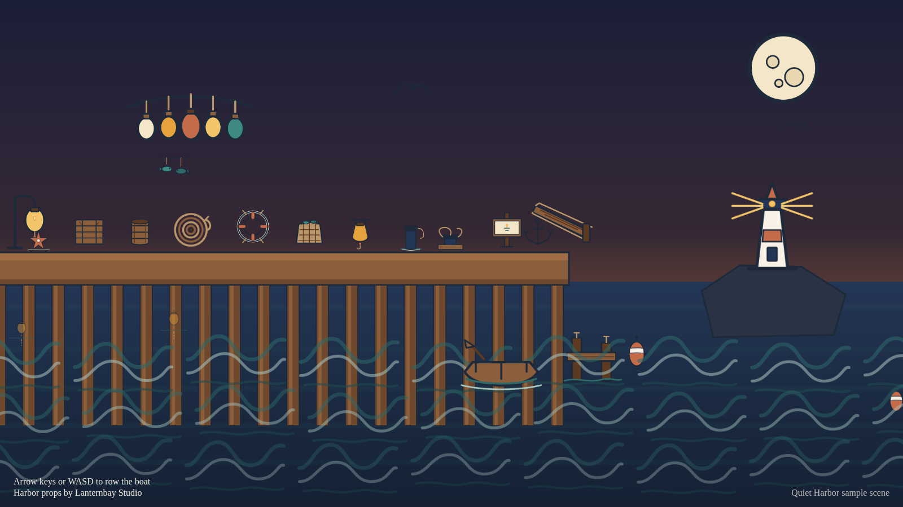

# Quiet Harbor sample scene

A small interactive harbor scene that uses free props from [Quiet Harbor Props](https://csvclinic.itch.io/quiet-harbor-props) by Lanternbay Studio.

Use the **arrow keys** or **WASD** to row the boat along the water.



## How to run

No build step is required.

- Open `index.html` in a modern browser, or
- Serve the folder and visit it locally:

```bash
python3 -m http.server 8080
```

Then open [http://localhost:8080/](http://localhost:8080/).


## Asset source

The props in this scene come from the free Quiet Harbor Props pack (version 1.0.0):

- itch.io: [https://csvclinic.itch.io/quiet-harbor-props](https://csvclinic.itch.io/quiet-harbor-props)
- GitHub: [https://github.com/dtpnm857jk-create/quiet-harbor-props](https://github.com/dtpnm857jk-create/quiet-harbor-props)

Only the 23 props used in the scene are included here, as 512×512 PNG exports, in `assets/png/`. This repository is a sample scene, not a redistribution of the full pack. The complete pack remains on itch.io.

## Asset license

The prop images are Copyright 2026 Lanternbay Studio. The license text below is copied verbatim from the pack's `LICENSE.txt` (the same file is also in the GitHub repository above). The copy in this repo is at `assets/LICENSE.txt`.

```
Quiet Harbor Props
Copyright 2026 Lanternbay Studio

Permission is granted, free of charge, to use, copy, modify, and
incorporate these assets into commercial or non-commercial games,
applications, videos, streams, educational materials, and other
original works.

Conditions
----------
1. Credit "Lanternbay Studio" in your credits, description, or an
   equivalent notice. A short line such as:

     Harbor props by Lanternbay Studio

   is enough.

2. Do not redistribute the original files, or a lightly modified
   copy, as a standalone asset pack, icon set, or stock collection.

3. Do not claim authorship of the original assets.

4. No trademark rights are granted. The name "Lanternbay Studio"
   remains with the publisher.

5. The assets are provided "as is", without warranty of any kind.

These files are original vector drawings created in code. They do
not include AI-generated images, stock photographs, or third-party
trademarks.
```

The HTML, CSS and JavaScript for this sample page are under the MIT License in `LICENSE`. That license does not cover the prop images.

## AI disclosure

This sample scene (the page, layout, and interaction) was made with AI assistance.

## Credits

Harbor props by Lanternbay Studio.
Sample scene by Lanternbay Studio, 2026.
